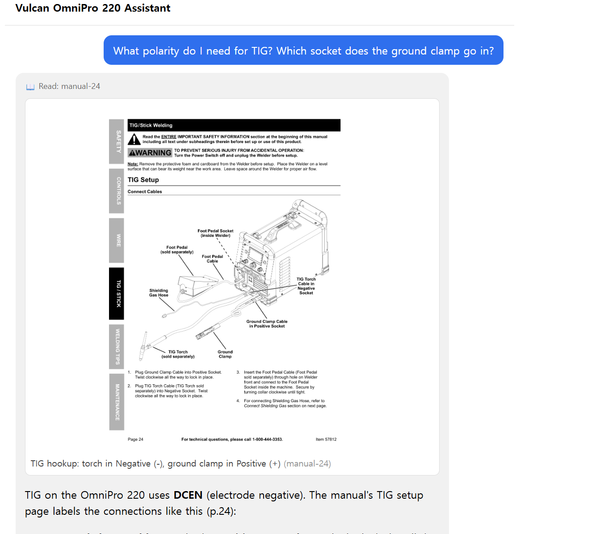
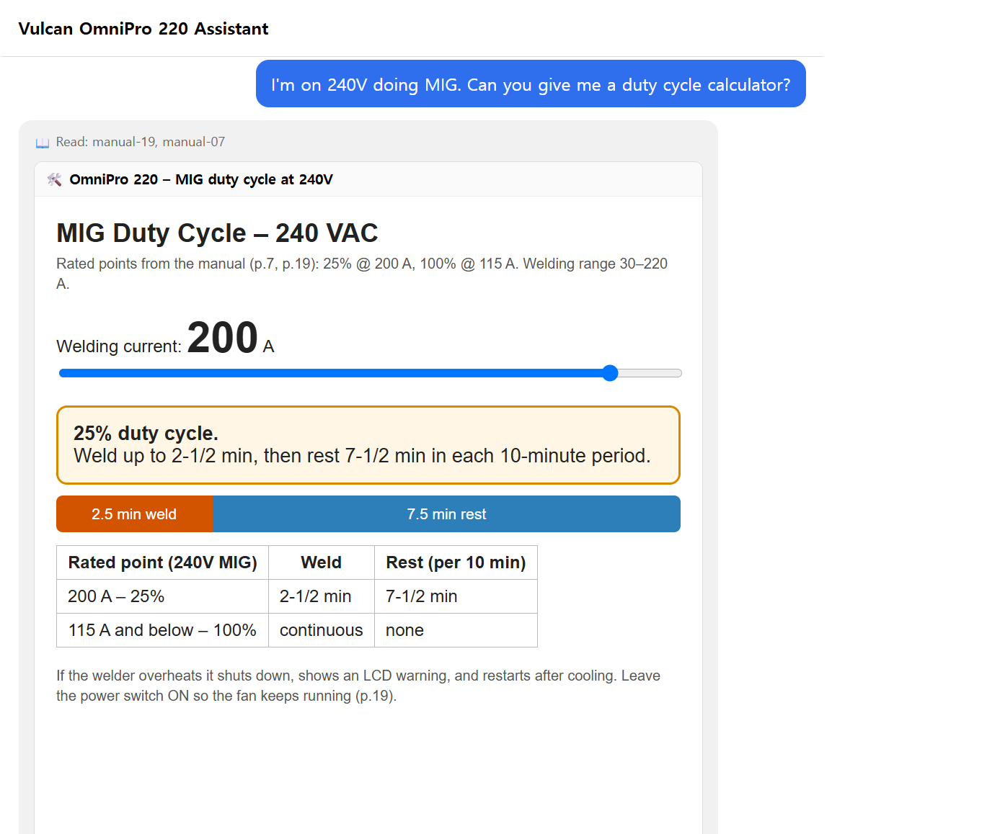
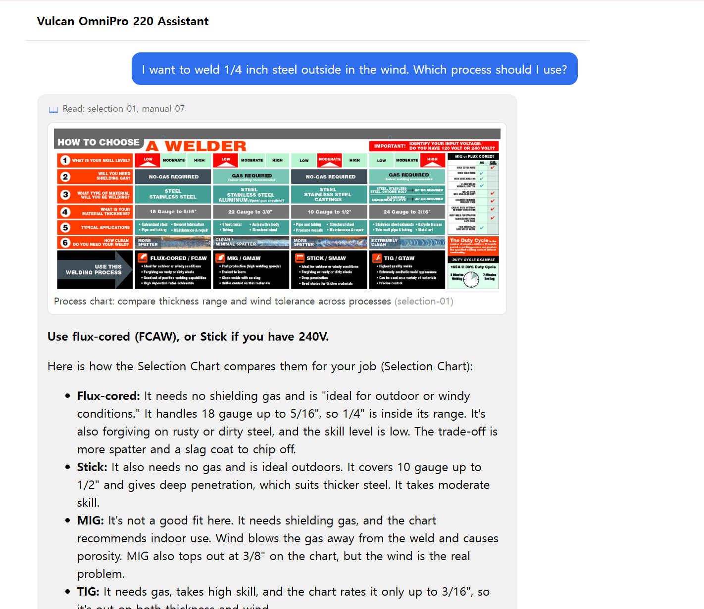
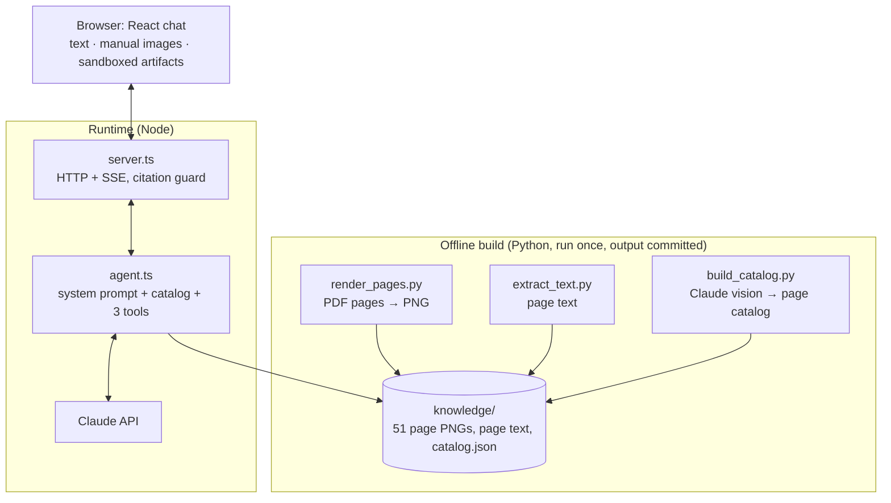

# OmniPro 220 Manual Agent

A multimodal support agent for the **Vulcan OmniPro 220** welder, built on the **Claude Agent SDK**. Ask it a setup or troubleshooting question and it reads the relevant manual pages (text *and* images), answers with page citations, shows the manual's own diagrams, and draws what words can't: socket hookup diagrams, a duty cycle calculator, troubleshooting flowcharts.



| Interactive duty cycle calculator | Process selection from an image-only chart |
|---|---|
|  |  |

---

## Quick start

Requires **Node.js 20+** (tested on Node 22, Windows and Linux).

```bash
git clone https://github.com/hapinza/multimodal-manual-agent.git
cd multimodal-manual-agent
cp .env.example .env        # put your Anthropic API key in .env
npm install                 # ~1-2 minutes
npm run dev                 # starts the agent server (:3001) and the web app
```

Open **http://localhost:5173** and click one of the example questions.

No Python is needed to run it. The extracted knowledge (page images, page text, page catalog) is committed to the repo, so there is no processing step at startup.

---

## Try these

The welcome screen has one-click examples, each chosen to show a different capability:

| Question | What it shows |
|---|---|
| What polarity do I need for TIG? Which socket does the ground clamp go in? | Reads p.24, answers, and **shows the manual's hookup diagram** |
| I'm on 240V doing MIG. Can you give me a duty cycle calculator? | Builds an **interactive calculator** from the rated points on p.7 and p.19, without inventing values in between |
| I'm getting porosity in my flux-cored welds. What should I check? | **Cross-references** the weld diagnosis page (p.37) and the troubleshooting table (p.43); leads with polarity (DCEN) |
| Where exactly is the negative socket on the front of the machine? | Information that exists **only in an image** (front panel, p.8) |
| I want to weld 1/4 inch steel outside in the wind. Which process should I use? | Reads the **process selection chart**, which has no extractable text at all |
| What's the duty cycle? | **Ambiguous question**: gives the general answer, then asks which process and input voltage |

Other things worth trying: *"Make me a troubleshooting flowchart for porosity"*, *"Draw which cable goes in which socket for flux-cored"*, *"On the wiring schematic, which connector does the wire feeder motor plug into?"*, or a wrong assumption like *"For TIG the ground clamp goes in the negative socket, right?"* (it corrects you).

---

## How it works



**One question, end to end** (*"I'm getting porosity in my flux-cored welds"*):

1. The React app opens a Server-Sent Events stream to `/api/chat`.
2. `server.ts` calls `ask()` in `agent.ts`, which runs the Claude Agent SDK with:
   - a system prompt (role, tone, and rules),
   - the **page catalog**: a one-paragraph summary of each of the 51 pages, so the model always knows where things are,
   - three tools.
3. Claude picks pages from the catalog and calls `get_page(["manual-37", "manual-43"])`. The tool returns each page's **image and text**, so the model reads the actual diagrams, not just a summary.
4. Claude calls `show_manual_page("manual-13", caption)` and/or `render_artifact(title, html)`. These tools only acknowledge; `server.ts` sees the calls in the stream and forwards them to the browser as `image` / `artifact` events.
5. The answer text streams back with page citations. The browser renders text, manual images, and artifacts in the order they arrived.

**The three tools**

| Tool | Who sees the result | Purpose |
|---|---|---|
| `get_page(ids)` | Claude | Read up to 4 pages at once: page image + extracted text |
| `show_manual_page(id, caption)` | User | Display a manual page in the chat |
| `render_artifact(title, html)` | User | Display a widget or diagram the model writes as self-contained HTML |

Follow-up questions continue the same conversation: the server returns the SDK session id on `done`, and the browser sends it back with the next question.

---

## How the knowledge is extracted and represented

The manual is 48 pages of dense text, tables, and drawings, plus a 2-page quick start guide and a 1-page process selection chart. Much of the critical information is visual: socket layouts, the wiring schematic, weld defect illustrations. The selection chart has **zero** extractable text.

**What I tried first, and what I found**

- Pulling embedded images out of the PDF misses most figures: over 30 pages report no embedded images even though almost every page has diagrams. They are vector drawings. So every page is **rendered to PNG** at 150 DPI, which captures everything and keeps small labels legible.
- The selection chart is a low-resolution JPEG sitting in the middle of a huge square page. Rendering it like the others produced a blurry 2500×2500 image that was mostly blank. For that page I extract the embedded JPEG and trim the white margin instead.

**The representation: a catalog for finding, the page itself for answering**

I considered three options:

| | Option | Problem |
|---|---|---|
| A | Put the whole manual's text in the prompt | Everything that exists only in images is lost; tables come out scrambled |
| C | Convert every page into structured text up front | Anything the extraction misses is gone for good, and wrong extractions fail silently |
| **B** | **A short catalog in the prompt + a tool that returns the real page** | Chosen |

The **catalog** (`knowledge/catalog.json`) was written by Claude vision (Opus), one page at a time, from the page image plus its text layer, using **structured outputs** so every entry has the same shape: title, section (from the manual's table of contents), summary, figures, keywords. Summaries are told to include facts that appear only in images (labels, socket names, chart values), because the catalog's job is to send the agent to the right page.

The catalog is for **routing**, not for answering. The answer comes from the page image and text that `get_page` returns. If the catalog sends the agent to a slightly wrong page, it opens another one. The eval logs show this happening (the porosity question opens 37 and 43, then 13 and 42).

Cost: building the catalog for all 51 pages took about $1, once. Answering a question costs about **3 cents** on average (Sonnet), helped by prompt caching of the ~14k-token system prompt.

---

## Design decisions

- **Runtime in TypeScript, extraction in Python.** Evaluators run only the Node app (`npm install` + `npm run dev`). Extraction runs once, uses PyMuPDF, and its outputs are committed.
- **The Agent SDK is locked down.** Built-in tools are disabled (`tools: []`), local Claude settings are ignored (`settingSources: []`), and `maxTurns` is capped. This agent sits behind a web UI and should only ever read the manual.
- **Rules come from evidence.** Every rule in the system prompt traces back to a requirement in the brief or a failure I observed: read before you state a machine-specific fact, cite pages, ask when the question is ambiguous, never invent specs, show figures instead of describing them.
- **Prompts ask, code enforces.** Where it matters, behavior is enforced in code, not just requested: zod schemas validate every tool input (page ids must exist, captions are capped at 140 characters), artifacts are sandboxed, and citations are checked before they reach the user (see Evals).
- **Artifacts are untrusted code.** The model writes HTML, and the browser runs it in an `<iframe sandbox="allow-scripts">` **without** `allow-same-origin`, plus a Content-Security-Policy that blocks all network access. The iframe reports its height through `postMessage`, and the parent only accepts a number from that specific iframe.
- **Generated artifacts vs. prebuilt widgets.** I let the model write the HTML so it can draw anything (a hookup diagram for *your* process, a flowchart for *your* defect). The trade-off is variance between runs; prebuilt components fed by structured data would be more consistent but limited to what I built.
- **Honest settings answers.** The OmniPro is synergic: after you pick the process, wire diameter, and thickness on the LCD, the machine sets wire speed and voltage itself (p.20). The exact table is a sticker inside the welder door and isn't in the PDFs. Asked for "exact wire speed and voltage", the agent gives the LCD procedure and the tuning guidance from p.35 instead of making up numbers.

---

## Evals: how the agent failed and what I changed

I tested the agent with a small eval suite (`server/evals/cases.json`) instead of by eye. Each case runs in a **fresh session** and is graded in code:

- pages it must read,
- phrases the answer must contain,
- whether it showed an image or an artifact,
- whether it asked a clarifying question,
- **numeric grounding**: every voltage or wire-speed number in the answer must appear on a page the agent actually read,
- **unopened citations**: page citations for pages the agent never opened.

```bash
npm run eval -w server                         # all cases
npm run eval -w server -- <case-id> --repeat=3 # some cases, several times
```

Results are saved to `server/evals/results/` so every change can be compared with the previous run.

**What I learned, in order**

1. **The model trusts what the tools return.** I planted a fake value (37% instead of the manual's 25%) in a tool result and the agent repeated it. So accuracy depends mostly on what reaches the context, which is why everything else here is about retrieval and grounding.
2. **Without retrieval, it answers from memory.** Before the catalog existed, it answered a porosity question from general welding knowledge: plausible, uncited, and it missed that the manual covers porosity on two different pages.
3. **It cites pages it never opened.** With the catalog in the prompt, the agent often quoted side facts straight from the catalog but cited them like pages it had read, e.g. "(p.22)". The facts were correct; the citation wasn't honest.
   - Prompt rule ("only cite pages you opened"): helped a little.
   - Hypothesis: opening each extra page costs a round trip, so it skips them. Change: `get_page` takes up to 4 ids at once. Result: unopened citations dropped from **8/12** answers (one run) to **16/36 (44%)** (three runs).
   - The rest were consistent side facts, always correct. So I enforced it in code: before text reaches the user, `server.ts` rewrites any citation of an unopened page as a pointer ("see p.22"). The eval reports both the raw model behavior and what users see: **after the guard, 0 unopened citations** in every run since.
4. **My first grader was wrong twice.** It read "Quick Start (p.2)" as manual page 2, and it failed an honest answer that quoted p.20's 24-gauge example numbers while explicitly warning not to use them. I replaced "no numbers allowed" with the numeric grounding check above, and re-graded the saved answers before changing anything else.
5. **One run is not a measurement.** A single run said unopened citations fell to 3/12; three runs said 16/36. I now report repeated runs.
6. **Vague rules get ignored.** "You may answer while asking" let the agent skip the clarifying question (1/3). Rewritten as a concrete action ("end with one short question about the missing detail") → 3/3.

**Current results** (final run: 18 cases × 3 = 54 runs)

| | Result |
|---|---|
| Cases | 18 (README examples, ambiguous question, image-only info, artifacts, safety, invented-numbers trap) |
| Pass rate | 52/54 |
| Invented numbers | 0 |
| User's wrong assumption corrected | 3/3 |
| Model cited a page it didn't open (raw) | 23/54 |
| Unopened citations reaching the user (after the citation guard) | 0/54 |
| Cost | $1.82 total, ~3 cents per question |

The two failures were one-off misses; each of those cases passed its other two runs. The raw unopened-citation rate stayed around 43% across every run, which is why the fix is in code (the citation guard) rather than in the prompt.

---

## Project structure

```
files/                  original PDFs (from the challenge)
extraction/             offline build (Python): render pages, extract text, build catalog
knowledge/              committed outputs: pages/*.png, page_text.json, catalog.json
server/src/
  agent.ts              system prompt, catalog, tools, ask()
  knowledge.ts          loads catalog, page text, page images
  server.ts             HTTP + SSE, forwards images/artifacts, citation guard, errors
  citations.ts          rewrites citations of unopened pages
  ask.ts                CLI:  npm run ask -w server -- "question"
  eval.ts               eval runner
server/evals/           eval cases and saved results
web/src/                React app (App.tsx, sandboxed Artifact.tsx)
docs/NOTES.md           full dev log: every experiment, failure, and decision
```

To rebuild the knowledge (not needed to run the app):

```bash
pip install pymupdf pillow anthropic python-dotenv
python extraction/render_pages.py
python extraction/extract_text.py
python extraction/build_catalog.py
```

---

## Limitations and next steps

- **Whole pages, not cropped figures.** The chat shows the full manual page. Cropping to the figure would be easier to read on long pages.
- **Can't fully prove runtime vision.** Most image-only facts also appear in the catalog (written from the images), so the eval can't always tell whether the answer came from the page image or the catalog. A separate experiment showed the model answering correctly from a page image alone; adding questions whose answers are in the image but not the summary would close this gap.
- **The citation check is a regex.** It can't tell a claim ("ground clamp in positive (p.22)") from a pointer ("the hookup is on p.17"), so the raw numbers are slightly pessimistic.
- **Pages read are tracked per answer.** In a follow-up question, a page opened in an earlier turn gets "see" if cited again.
- **No exact settings table.** The manufacturer's settings chart isn't in the provided documents, so the agent can't give exact wire speed and voltage for a given thickness.
- **Sessions live on the machine running the server** (Agent SDK session files). Fine for a local demo; a hosted version would need its own session storage and per-user limits.
